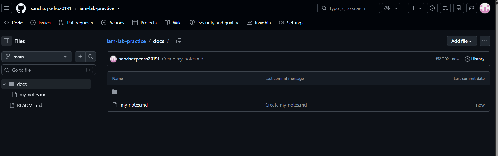

  # Publishing My First Repo

## Project Overview

In this Project I learned how to create a Repo, a README inside that Repo, and how to use Markdown. 

## Business Scenario

Zero to Sec: Created A Repo on Github

## Tools Used

- Microsoft Entra ID

## What I Built

- Repo
- Folders
- README
- Adding Screenshots

## Screenshots

## Security lessons learned

What I Learned in this Lab was how to create a Repo from scratch. How to create folders and how to use Markdowns to create headings and add screenshots.

## Future Improvements
      
Step 5 tripped me up a bit when re-naming the screenshot file practice-shot.png. Every time I saved it and clicked the link I got an error. Reason being I did not have to add the png to file name just "practice-shot". File will be saved as a PNG.
